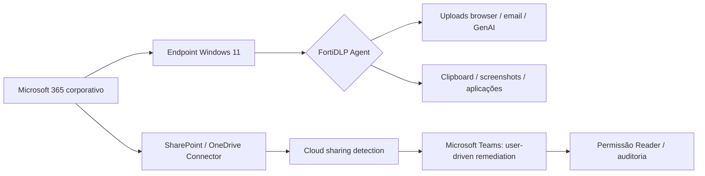

# FortiDLP — Public Demo Lab

**Demonstração prática de Data Loss Prevention, SaaS Data Security, GenAI e controlo de aplicações.**

Repositório de referência para reproduzir uma PoC técnica de FortiDLP num ambiente **exclusivamente laboratorial**, sem dados de clientes, sem credenciais, sem configurações exportadas de produção e sem evidências identificáveis.

> **Estado:** documentação baseada em testes observados num laboratório Windows 11 / FortiDLP Agent **12.8.1** / Policy Templates **8.7.0**, em outubro de 2026. Não é uma matriz oficial de suporte nem uma garantia de comportamento noutras versões.

## O que demonstra

| ID | Use case | Comportamento observado | Estado |
|---|---|---|---|
| UC01 | Origem corporativa e Data Lineage | Rastreabilidade após cópia/movimento/rename; upload interrompido com override auditável | ✅ Validado |
| UC02 | Proteção de screenshots | Deteção de captura e limpeza do clipboard | ✅ Validado |
| UC03 | Microsoft Purview sensitivity labels | Deteção e coaching em upload pelo browser | ◐ Parcial |
| UC04 | Dados pessoais colados em aplicações GenAI desktop | Deteção e coaching em aplicações nativas | ✅ Deteção validada |
| UC05 | Outbound Email DLP | Bloqueio de email externo com identificadores pessoais ou email classificado | ✅ Validado |
| UC06 | GenAI Web Prompt Protection | Bloqueio de pedido ChatGPT Web; input evidence; popup | ✅ Validado |
| UC07 | Cloud pessoal versus corporativa | Política configurada; diferenciação de identidade e enforcement não totalmente validados | ◐ Pendente |
| UC08 | Remediação OneDrive via Teams | Partilha com edição → notificação Teams → `Reader` | ✅ Validado |
| UC09 | Bloqueio de ChatGPT Desktop | `Kill process` + coaching após arranque limpo | ✅ Validado |
| UC10 | Cliente de email não autorizado | Thunderbird terminado; URI nativo abre New Outlook | ✅ Validado |
| UC11 | Network recon / Nmap | Deteção de scan mais abrangente, sem terminar processo | ✅ Deteção validada |

**Backlog:** Wireshark/packet capture (não validado), OCR FortiDLP (não confirmado), Agentic AI Inventory e inspeção MCP (não demonstrados).

## Começar em 5 minutos

**Setup obrigatório:** [Preparar a PoC](docs/setup/README.md) → [Instalação Windows](docs/setup/windows-11.md) → [Policy Group + labels/scope](docs/setup/policy-scope.md) → [Integrações Teams/M365](docs/setup/integrations.md) → [Preflight de 5 minutos](docs/operations/preflight.md).

**Label `dlp_rc_demos` no endpoint E no utilizador**; Policy Group `PG-FortiDLP-Demo`. Em especial, a remediação OneDrive/Teams (UC08) requer **scope no utilizador**. Cada use case terá uma vista operacional com fluxograma, pré-requisitos e resultados.

## Navegação

- [Arquitetura, versões e pré-requisitos](docs/architecture.md)
- [Catálogo detalhado de políticas (UC01–UC11)](docs/policy-matrix.md)
- [Guião de apresentação — 35 a 45 minutos](docs/demo-script.md)
- [Runbook de preparação e execução](docs/operations/runbook.md)
- [Troubleshooting / lições aprendidas](docs/operations/troubleshooting.md)
- [Resultados e limitações](docs/test-results.md)
- [Boas práticas antes de publicar evidências](docs/publication-safety.md)
- [Use cases individuais](docs/use-cases/)
- [Modelos de coaching / popups](examples/coaching-messages.md)
- [Prompts e conteúdo de teste](examples/test-fixtures.md)
- [Como publicar no GitHub](PUBLISH.md)

## Percurso demonstrativo

## Cinco princípios da PoC

1. **Distinguir deteção de prevenção.** Só marcar *bloqueado* quando a ação conclui com `Succeeded`.
2. **Distinguir bloqueio de override.** Um upload autorizado por exceção não equivale a exfiltração impedida.
3. **Não confundir aplicação SaaS sancionada com conta corporativa.** A identidade pode aparecer como `unknown`.
4. **Não associar capacidades não validadas a resultados comprovados.** MPIP nos anexos de email e OCR são exemplos.
5. **Não publicar informação de produção.** Todo o material aqui é genérico/sintético; ver [PUBLICATION-SAFETY](docs/publication-safety.md).

## Referências oficiais

- [FortiDLP — Data lineage / Detection details](https://docs.fortinet.com/document/fortidlp/1.0.0/fortidlp-console-user-guide/348255)
- [FortiDLP — Website parameters / account types](https://docs.fortinet.com/document/fortidlp/1.0.0/fortidlp-policies-reference-guide/940910)
- [FortiDLP — Content inspection](https://docs.fortinet.com/document/fortidlp/latest/fortidlp-policies-reference-guide/244425/content-inspection-parameters)
- [FortiDLP — Sharing remediation](https://docs.fortinet.com/document/fortidlp/latest/fortidlp-console-user-guide/981804)
- [FortiDLP — Teams interactive messages](https://docs.fortinet.com/document/fortidlp/latest/fortidlp-console-user-guide/361558/send-message-to-slack-or-teams-preview)
- [FortiDLP — Insider threat templates](https://docs.fortinet.com/document/fortidlp/1.0.0/fortidlp-policies-reference-guide/809044)
- [FortiDLP — Email templates](https://docs.fortinet.com/document/fortidlp/1.0.0/fortidlp-policies-reference-guide/329056/email-templates)

## Âmbito e utilização

Material comunitário e **não oficial**, destinado a demonstrações em ambientes autorizados. As marcas e produtos mencionados pertencem aos respetivos titulares. Este repositório não inclui exports de policies, tokens, credenciais, dados pessoais reais ou capturas da consola com identidades reais.
