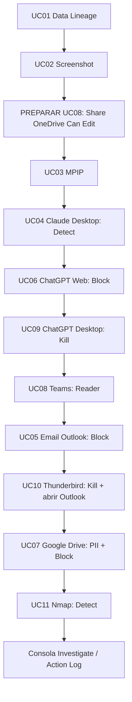

# Guião de apresentação FortiDLP — sequência validada no dry run

**Ambiente:** Windows 11 / FortiDLP Agent 12.8.1 / Policy Templates 8.7.0.  
**Uso:** apresentação técnica de 35–45 min; adaptar tempos sem alterar o encadeamento.  
**Mapa de uma página:** [presentation-flow.md](presentation-flow.md).  
**Texto pronto a colar:** [live-demo-paste.txt](../examples/live-demo-paste.txt).  
**Checklist:** [preflight.md](operations/preflight.md).

## A história — uma cadeia lógica

## 0. Preparação antes do público chegar (5 min)

Confirmar Agent online, `dlp_rc_demos` no endpoint **e** utilizador, policies publicadas, browser monitoring, Microsoft 365/Teams integration, email add-in e aplicações. Preparar `https.docx`, `OnlyMPIP.docx`, `Ficha-Condutor.docx` e partilha `Cloud-Sharing-Demo.docx`.

Abrir em separadores OneDrive, Google Drive de laboratório, ChatGPT Web, FortiDLP Console e Teams. Fechar instâncias antigas de ChatGPT Desktop. Ter pronto o [ficheiro TXT](../examples/live-demo-paste.txt) para copiar os blocos sem memorizar dados.

## 1. UC01 — O dado conserva a origem (4 min)

**Dizer:** “Um utilizador pode descarregar um documento corporativo, movê-lo e alterar o nome ou extensão. A proteção não deve depender do nome.”

**Mostrar:** OneDrive `https.docx` → Edge download → mover → renomear `sapo.jpg` → upload externo → popup com override justificado → Detection, MIME DOCX, Data Lineage e Action Log.

**Conclusão:** *exceção autorizada e auditável*; não chamar “bloqueio definitivo” quando o utilizador continua.

## 2. UC02 — Screenshot + iniciar o relógio da cloud (3 min)

**Dizer:** “Se não consegue retirar o ficheiro, pode tentar tirar uma captura do ecrã.”

**Mostrar:** Word → `Win+Shift+S` → captura → popup → `Empty Clipboard` → Paint, colar sem sucesso.

**SEM PARAR A APRESENTAÇÃO:** ir ao OneDrive e **partilhar `Cloud-Sharing-Demo.docx` com um contacto externo de laboratório, com permissão Can edit**. Não esperar pelo Teams; avançar imediatamente. O evento deverá aparecer mais tarde.

## 3. UC03 — MPIP na origem (2 min)

**Dizer:** “Além de padrões, reconhecemos a classificação existente no documento.”

**Mostrar:** `OnlyMPIP.docx` → label `PoC-HighlyConfidential` → upload Edge → deteção criada pela `DEMO-03`.

**Conclusão:** classificação reconhecida e coaching; não prometer bloqueio da UC03 sem uma ação provada.

## 4. UC04 → UC06 → UC09 — Três controlos GenAI (8 min)

**Dizer, no início:** “Vamos reutilizar os mesmos dados de laboratório em diferentes canais.”

**UC04:** copiar **BLOCO A** do [TXT](../examples/live-demo-paste.txt) para Word → copiar de Word para **Claude Desktop** → paste → popup → deteção `DEMO-04B`. **Não enviar.** “Na aplicação nativa, este template deteta, mas não bloqueia o conteúdo.”

**UC06:** abrir **ChatGPT Web no Edge** → colar **o mesmo BLOCO A** → Send → popup e bloqueio. Na consola: `Block browser request — Succeeded`, `Capture input evidence — Succeeded`. “No browser, impedimos a submissão.”

**UC09:** fechar todas instâncias antigas ChatGPT.exe → abrir **ChatGPT Desktop** → observar término e popup. Na consola: `Kill process — Succeeded`. “A aplicação nativa não autorizada também pode ser terminada.” **Não extrapolar para todo o GenAI desktop.**

## 5. UC08 — Fechar a partilha do OneDrive via Teams (4 min)

**Ponte:** “Enquanto protegíamos o endpoint, o evento de partilha foi ingerido na cloud.”

**Mostrar:** Teams → mensagem FortiDLP sobre partilha com `Can edit` → utilizador clica botão de remediação → permissões passam a `Reader` no OneDrive → Cloud Action Log `Succeeded`.

**Plano B:** se não chegou a tempo, não bloquear a apresentação: continuar com UC05/10 e retomar no fecho.

## 6. UC05 → UC10 — Duas faces de proteção de email (6 min)

**UC05, dizer:** “O email corporativo também é um canal de saída sensível.” New Outlook com Email Add-in → assunto/corpo do [TXT](../examples/live-demo-paste.txt) → anexo `Ficha-Condutor.docx` com PII sintética → destinatário externo de laboratório → Send → `Block outbound email — Succeeded`.

**Ponte UC10:** “E se tentar usar um cliente de email que contorna a stack aprovada?” Abrir Thunderbird → popup e `Kill process` → clicar `Abrir Outlook corporativo` → New Outlook nativo via `ms-outlook:`.

**Nota:** teste de MPIP **somente no anexo** do email, sem label na mensagem, não deu match anteriormente.

## 7. UC07 — Cloud storage sem sessão corporativa verificada (3 min)

Criar documento **novo e local** `Cloud-PII-Local.docx` com conteúdo do [TXT](../examples/live-demo-paste.txt), sem label MPIP e sem origem OneDrive; Google Drive de laboratório, upload. `DEMO-07` deve fazer match por **PII**, com `Non-corporate + Unknown`; apresentar `Block browser upload` e verificar Action Log.

**Mensagem:** “Podemos agir contra dados sensíveis enviados para sessões que não foram identificadas como corporativas. `Unknown` não equivale a ter reconhecido uma conta pessoal.”

**Detalhe de validação:** o dry run confirmou as deteções PII e MPIP e o operador reportou bloqueio concluído; a captura `Block browser upload — Succeeded` do último reteste não foi partilhada nesta conversa. Confirmá-la antes da sessão externa.

## 8. UC11 — Reconhecimento de rede (2 min)

**Dizer:** “Para além de exfiltração, a plataforma observa comportamentos de risco no endpoint.”

Abrir deteção de scan de rede **autorizado** já recolhida. Mostrar `Created by DEMO-11`, `num_ports` e `remoteAddr`. Não executar novo scan extenso a serviços públicos sem autorização. **Deteção, não Kill nem Isolate.**

## 9. Encerramento — Investigate (3 min)

Mostrar em sequência: **UC01** (linhagem + override) → **UC06** (bloqueio efetivo + input evidence) → **UC08** (correção de permissões na fonte via Teams).

**Fecho:** “Não é apenas gerar alertas: é identificar a origem da informação, aplicar prevenção nos canais suportados, auditar exceções e corrigir exposição diretamente no serviço cloud.”

## Considerações de precisão

- As políticas GenAI têm cobertura e ações **diferentes** para native e Web; não alegar proteção absoluta de todas as aplicações.
- UC03 mostra classificação, UC04 mostra deteção e UC11 mostra comportamento; não lhes atribuir bloqueios não testados.
- UC07 usa `Non-corporate + Unknown`; o último reteste da ação deverá estar no Action Log privado.
- Todos os dados e contas são de laboratório; não divulgar evidências originais em repositório público.
