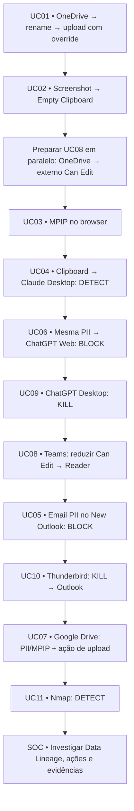

# Mapa de apresentação — FortiDLP (dry run 29/10/2026)

**Objetivo:** seguir o **encadeamento testado** sem ler os 11 documentos completos.  
**Ver texto para copiar/colar:** [`examples/live-demo-paste.txt`](../examples/live-demo-paste.txt).  
**Runbook longo:** [`docs/demo-script.md`](demo-script.md).

## Preparação obrigatória — 5 minutos

- [ ] Agent Windows **12.8.1** online; templates **8.7.0**; policy group `PG-FortiDLP-Demo` publicado.
- [ ] Label `dlp_rc_demos` aplicada **à WIN11-DLP e ao utilizador**. Para UC08, a label no utilizador é crítica.
- [ ] Edge (browser monitoring), Word, Snipping Tool, OneDrive corporativo, Google Drive de laboratório.
- [ ] New Outlook + **FortiDLP Email Add-in**, Thunderbird, Claude Desktop, ChatGPT Desktop, Nmap.
- [ ] Microsoft 365 connector SharePoint/OneDrive e Teams saudáveis; **app FortiDLP instalada no Teams**.
- [ ] Documentos `https.docx`, `OnlyMPIP.docx` (label `PoC-HighlyConfidential`), `Ficha-Condutor.docx` (PII fictícia).
- [ ] UC07: DOCX **local sem MPIP**, `Non-corporate + Unknown`, `Block browser upload` sem override.
- [ ] Ações antigas/duplicadas de debug desativadas; deteções anteriores abertas como plano B.

## Fluxograma — encadeamento que funcionou

> **Crítico:** a partilha UC08 é criada **durante a UC02**, mas o clique de remediação é mostrado **depois da UC09**, quando o evento já estiver no Teams.

## Cartão do apresentador — seguir a ordem

| Ordem | UC | Preparação e gesto | O que mostrar na consola | Fecho da história |
|---|---|---|---|---|
| 1 | **01** | Edge OneDrive: descarregar `https.docx` → mover → `sapo.jpg` → upload Google Drive | Data Lineage, MIME DOCX, override com justificação | Origem corporativa preservada |
| 2 | **02** | Word aberto → `Win+Shift+S` → screenshot → `Ctrl+V` no Paint | Empty Clipboard `Succeeded` | Captura protegida |
| 2a | **Pré-UC08** | **Sem pausa:** OneDrive, partilhar ficheiro sintético com contacto externo de laboratório, permissão **Can edit** | Apenas preparar evento; prosseguir | Ingestão cloud decorre em paralelo |
| 3 | **03** | Word `OnlyMPIP.docx` → confirmar label → upload Edge | Detection `DEMO-03` por label | Sensitivity Label reconhecida; não prometer block |
| 4 | **04** | Copiar [BLOCO A](../examples/live-demo-paste.txt) do Word → colar Claude Desktop, **não enviar** | `DEMO-04B` → `claude.exe`, PII | Native: deteção, sem block de prompt |
| 5 | **06** | Colar **o mesmo BLOCO A** no ChatGPT Web → enviar | `Block browser request — Succeeded`, Input Evidence | Web: bloqueio efetivo |
| 6 | **09** | Fechar processos antigos, abrir ChatGPT Desktop | `Kill process — Succeeded` | Evitar bypass via app não autorizada |
| 7 | **08** | Teams: abrir pedido UC08 já recebido → clicar remediação | Contribute → Reader, Cloud Action `Succeeded` | Corrigir partilha na fonte |
| 8 | **05** | New Outlook, email externo de laboratório + `Ficha-Condutor.docx` | `Block outbound email — Succeeded` | Email externo bloqueado |
| 9 | **10** | Thunderbird → Kill → clicar `Abrir Outlook corporativo` | `Kill process — Succeeded` | Cliente não autorizado bloqueado |
| 10 | **07** | Google Drive de laboratório + DOCX **local sem MPIP** com PII | `Created by DEMO-07`, Action Log; ficheiro ausente no Drive | Content inspection + upload block, se `Succeeded` |
| 11 | **11** | Nmap apenas com alvo autorizado, ou deteção anterior | `DEMO-11`, `num_ports` / destino | Deteção comportamental, não Kill |

## Frases de ponte (curtas)

- **UC01 → UC02:** “Mesmo que não transfira o ficheiro, pode tentar capturar o ecrã.”
- **UC04 → UC06:** “Na app nativa detetamos o paste; no Web impedimos o envio dos mesmos dados.”
- **UC06 → UC09:** “Se tentar contornar pelo ChatGPT Desktop, terminamos a app não autorizada.”
- **UC09 → UC08:** “Enquanto fazíamos estas ações, o conector cloud detetou a partilha: vamos corrigi-la no Teams.”
- **UC05 → UC10:** “E se tentar usar outro cliente de email? O Thunderbird é terminado e abrimos o Outlook.”
- **UC07 → UC11:** “Além do movimento de dados, também detetamos comportamentos de reconhecimento de rede.”

## Contingências críticas

- **UC07:** `Unknown` = identidade SaaS **desconhecida**; não provar conta pessoal. Deteção por PII/MPIP comprovada; ação Block deve ser verificada no último Action Log.
- **UC08:** evento cloud pode levar cerca de 3 minutos; se não tiver chegado, continuar e voltar no final.
- **UC09:** `ChatGPT.exe` é multiprocesso; fazer clean start.
- **UC11:** evitar scans intensivos em servidores públicos durante a apresentação; uma deteção anterior demonstrável pode ser mais robusta.
- **UC03/UC04:** deteção não equivale a bloqueio.

**Último slide:** Data Lineage + Action Logs + evidências/justificações + Teams Reader.  
Não publicar screenshots, nomes reais, IDs nem dumps de console em repositório público.
