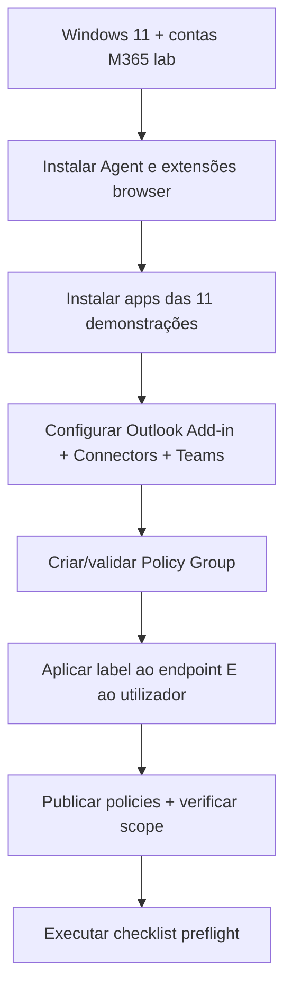

# Preparação da PoC FortiDLP — começar aqui

> Laboratório observado: **Windows 11 + FortiDLP Agent 12.8.1 + Policies/Templates 8.7.0**. Estas versões são as usadas nos testes, não uma afirmação de mínimos oficiais.

## Ordem de preparação

## Checklist geral

- [ ] VM Windows 11 de laboratório, snapshot antes dos testes e utilizador com sessão Microsoft 365.
- [ ] **FortiDLP Agent 12.8.1** enrolled, Healthy, com Agent configuration group atribuído.
- [ ] Policies/Templates **8.7.0** e grupo **`PG-FortiDLP-Demo`**; UC01–UC11 Enabled e publicadas.
- [ ] **Label `dlp_rc_demos` no endpoint Windows** (UC01–07 e UC09–11).
- [ ] **Label `dlp_rc_demos` também no utilizador Microsoft 365** (fundamental para UC08).
- [ ] Browser monitoring e extensão FortiDLP instalada/ativa no Edge.
- [ ] Clipboard, screenshot e email monitoring conforme cada use case.
- [ ] New Outlook + FortiDLP Email Add-in (UC05) e protocolo `ms-outlook:` testado (UC10).
- [ ] Cloud Connector Microsoft SharePoint/OneDrive e Teams integration Healthy; **app FortiDLP instalada no Teams do utilizador** (UC08).
- [ ] Ficheiros, contas externas e destinatários **exclusivamente fictícios/de laboratório**.
- [ ] Deteções confirmadas de backup para as ações mais demoradas.

**Atenção:** associar a label ao computador **não substitui** associá-la ao utilizador para cloud-native events. No laboratório, a UC08 só disparou depois de configurar scope no **utilizador**.

## Abrir na sequência

1. [Software e aplicações Windows](windows-11.md)
2. [Policy Group, labels, aplicação do scope e matriz UC](policy-scope.md)
3. [Integrações M365, Teams e contas externas](integrations.md)
4. [Preflight — 5 minutos](../operations/preflight.md)
5. [Use cases com fluxogramas passo a passo](../use-cases/)

Não publicar exports de policies, dados reais, nomes de tenants, IP de gestão, UPNs de utilizadores ou screenshots não anonimizados.
