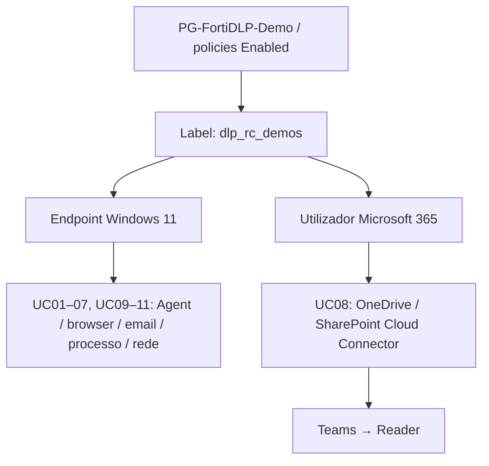

# Policies, labels e âmbito — endpoint versus utilizador

## Nomes concretos usados na PoC

| Objeto | Nome | O que fazer |
|---|---|---|
| Policy Group | **`PG-FortiDLP-Demo`** | Conter/organizar as policies UC01–UC11 |
| Label de scope | **`dlp_rc_demos`** | Aplicar **ao endpoint e ao utilizador** de demonstração |
| Endpoint | VM Windows 11 do laboratório | Verificar label, Agent Healthy, sincronização e policies |
| Utilizador | Identidade M365 que partilha ficheiros | Verificar **label no user** e cloud policy configurada |

São identificadores de laboratório, não nomes de clientes. Em outro tenant, podem ser substituídos por nomes equivalentes.

## Publicar e verificar

1. Confirmar `PG-FortiDLP-Demo`, templates e políticas **Enabled**.
2. Atribuir **`dlp_rc_demos` ao endpoint** que executa o Agent.
3. Atribuir **`dlp_rc_demos` ao utilizador Microsoft 365** que faz as partilhas.
4. Verificar **View scope / Configured Policies** para as entidades adequadas.
5. Publicar/sincronizar e **produzir um novo evento** para cada verificação.
6. Desativar regras antigas de teste duplicadas que possam gerar match antes da UC desejada.

| UC | Endpoint com label | Utilizador com label | Policy da PoC |
|---|:---:|:---:|---|
| 01 | ✅ | Recomendado | `DEMO-01 \| Corporate Source Protection` |
| 02 | ✅ | Recomendado | `DEMO-02 \| Corporate Screenshot Protection` |
| 03 | ✅ | Recomendado | `DEMO-03 \| MPIP Confidential Protection` |
| 04 | ✅ | Recomendado | `DEMO-04B \| Sensitive Data Pasted to GenAI` |
| 05 | ✅ | Recomendado | `DEMO-05A \| Personal Data Email Protection` |
| 06 | ✅ | Recomendado | `DEMO-06 \| GenAI Prompt Protection` |
| 07 | ✅ | Recomendado | `DEMO-07 \| Personal Cloud Protection` |
| **08** | Não substitui scope cloud | **✅ Obrigatório no teste** | `DEMO-08 \| Cloud Sharing Remediation` |
| 09 | ✅ | Recomendado | `DEMO-09 \| Unauthorized GenAI Desktop` |
| 10 | ✅ | Recomendado | `DEMO-10 \| Unauthorized Email Client` |
| 11 | ✅ | Recomendado | `DEMO-11 \| Excessive Network Reconnaissance` |

### O erro real da UC08

O Cloud Connector já recolhia eventos OneDrive no **Activity Feed**, mas **não havia Detection**. A label só estava no **endpoint**. Depois de associar a mesma label ao **utilizador**, as deteções começaram a surgir.

**Não confundir:** Activity Feed (evento do conector) ≠ Detection (match da policy) ≠ Action Log (remediação bem-sucedida).
