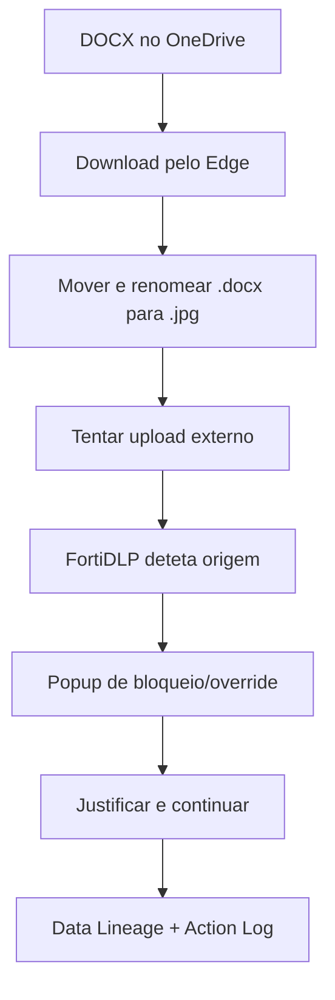

# UC01 — Data lineage, bloqueio e override

> **GUIÃO RÁPIDO:** preparação + fluxograma + resultado. [Setup completo](../setup/README.md) · [Checklist 5 min](../operations/preflight.md)

## 0. Preparação rápida

| Item | Verificar |
|---|---|
| Aplicações | Edge, Word, OneDrive corporativo e cloud externo de laboratório |
| Label / scope | Endpoint `dlp_rc_demos` |
| Policy Enabled | `DEMO-01 | Corporate Source Protection` |

- [ ] DOCX colocado no OneDrive e descarregado pelo Edge
- [ ] Block browser upload com Allow user override e justificação ON
- [ ] Sessão de cloud externa de teste pronta

## 1. Fluxograma — executar pela ordem indicada

## 2. O que comprovar na consola

Origem preservada apesar de rename; upload permitido **por exceção auditável**; `Block browser upload with user override — Succeeded`.

## 3. Plano B

Abrir detecção anterior com Data Lineage, motivo de override e evidências anonimizadas.

---

## Detalhe técnico e evidências

**Estado:** **Validado** (incluindo evidências e decisão de override).

## Política e condições
`Sensitive file uploaded` com *File origin* baseado em OneDrive/SharePoint; sem depender exclusivamente do nome ou extensão.

## Ações
`Block browser upload` com `Allow user override`, justificação obrigatória, evidência de ficheiro e screenshot; coaching contextual.

## Reproduzir no laboratório
1. Guardar um DOCX de laboratório no OneDrive corporativo e descarregá-lo no Edge.
2. Copiar/mover o ficheiro e renomear `source.docx` para `renamed.jpg` (alteração de extensão, **sem conversão**).
3. Tentar upload do ficheiro para armazenamento cloud de teste.
4. No diálogo, escolher uma justificação e continuar.
5. Consultar Detection Details → Origin/Data Lineage → Associated Actions.

## Resultado observado
Reconhecimento do DOCX real apesar de extensão JPG; origem OneDrive e operações copy/move/rename preservadas. `Block browser upload with user override — Succeeded`; override registado; screenshot e file evidence obtidas. A transferência avançou **por exceção**, não foi impedida definitivamente.

## Limitações e notas
Preparar dois percursos separados: Cancel (bloqueio) e Continue (exceção); não confundir as respetivas evidências. Evitar afirmar intenção maliciosa só por haver rename.

## Evidências a recolher (privadamente)
- Policy / template e versão, com scope aplicável.
- Timestamp, endpoint/utilizador fictício e evento que originou a deteção.
- `Associated actions`, respetivos estados e `Action log`.
- Apenas prints **redigidos/anonimizados**, sem emails reais, URL com tokens, paths de perfil, IDs de tenant ou conteúdo pessoal.
