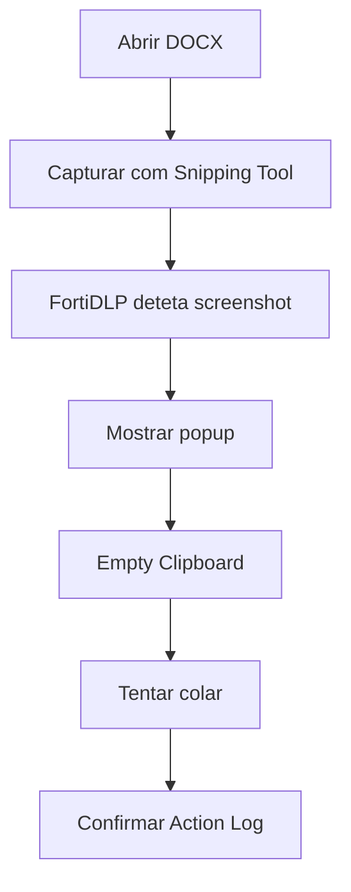

# UC02 — Screenshot e limpeza do clipboard

> **GUIÃO RÁPIDO:** preparação + fluxograma + resultado. [Setup completo](../setup/README.md) · [Checklist 5 min](../operations/preflight.md)

## 0. Preparação rápida

| Item | Verificar |
|---|---|
| Aplicações | Word e Snipping Tool |
| Label / scope | Endpoint `dlp_rc_demos` |
| Policy Enabled | `DEMO-02 | Corporate Screenshot Protection` |

- [ ] DOCX sintético aberto no Word
- [ ] Screenshot e Clipboard Monitoring ON
- [ ] Display Message e Empty Clipboard ativos

## 1. Fluxograma — executar pela ordem indicada

## 2. O que comprovar na consola

Deteção de screenshot, mensagem e `Empty Clipboard` concluído.

## 3. Plano B

Mostrar Detection de backup; evitar regras duplicadas capture/save.

---

## Detalhe técnico e evidências

**Estado:** **Validado** (deteção e `Empty Clipboard`).

## Política e condições
`Screenshot taken`, monitorização de captura e aplicação protegida em ecrã.

## Ações
`Display message` e `Empty Clipboard`; não duplicar alertas ao ativar simultaneamente monitorização de capture e save.

## Reproduzir no laboratório
1. Abrir um documento sintético num editor Office.
2. Iniciar uma captura com a ferramenta de screenshots do Windows.
3. Observar a notificação; tentar colar a captura.
4. Consultar deteção e processos associados.

## Resultado observado
Evento de screenshot gerado; processo da ferramenta e aplicação capturada identificados; clipboard limpo com sucesso.

## Limitações e notas
Screenshot como **evento** não é a mesma coisa que `Capture screenshot evidence` como ação forense. Reduzir popups duplicados.

## Evidências a recolher (privadamente)
- Policy / template e versão, com scope aplicável.
- Timestamp, endpoint/utilizador fictício e evento que originou a deteção.
- `Associated actions`, respetivos estados e `Action log`.
- Apenas prints **redigidos/anonimizados**, sem emails reais, URL com tokens, paths de perfil, IDs de tenant ou conteúdo pessoal.
