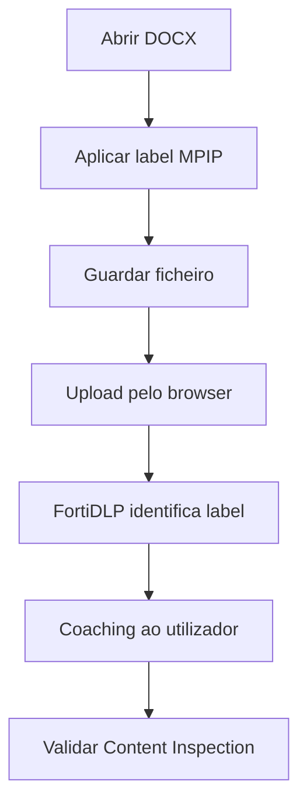

# UC03 — Microsoft Purview / label no browser

> **GUIÃO RÁPIDO:** preparação + fluxograma + resultado. [Setup completo](../setup/README.md) · [Checklist 5 min](../operations/preflight.md)

## 0. Preparação rápida

| Item | Verificar |
|---|---|
| Aplicações | Word com Sensitivity Labels e Edge |
| Label / scope | Endpoint `dlp_rc_demos` |
| Policy Enabled | `DEMO-03 | MPIP Confidential Protection` |

- [ ] Label MPIP de laboratório publicada ao utilizador
- [ ] Aplicar label ao DOCX no Word e guardar
- [ ] Policy Sensitive file uploaded com filtro MPIP

## 1. Fluxograma — executar pela ordem indicada

## 2. O que comprovar na consola

Deteção e coaching validado. **Não** declarar bloqueio validado nesta UC.

## 3. Plano B

Mostrar Detection com a classificação reconhecida.

---

## Detalhe técnico e evidências

**Estado:** **Parcial** (deteção e coaching).

## Política e condições
`Sensitive file uploaded` com Microsoft Sensitivity Label de teste, por exemplo `Lab-Confidential` (substituir pela etiqueta real de laboratório).

## Ações
`Display message` confirmado; `Block browser upload` **não confirmado** nesta UC.

## Reproduzir no laboratório
1. Aplicar uma label MPIP a um DOCX de laboratório.
2. Guardar, reabrir e verificar a classificação.
3. Tentar upload através do Edge.
4. Inspecionar `Content Inspection` na deteção.

## Resultado observado
A classificação MPIP foi reconhecida em upload de DOCX via browser. Deteção e coaching observados.

## Limitações e notas
Não inferir que a inspeção de anexo etiquetado no New Outlook tem cobertura igual; há um teste negativo não resolvido descrito em UC05.

## Evidências a recolher (privadamente)
- Policy / template e versão, com scope aplicável.
- Timestamp, endpoint/utilizador fictício e evento que originou a deteção.
- `Associated actions`, respetivos estados e `Action log`.
- Apenas prints **redigidos/anonimizados**, sem emails reais, URL com tokens, paths de perfil, IDs de tenant ou conteúdo pessoal.
