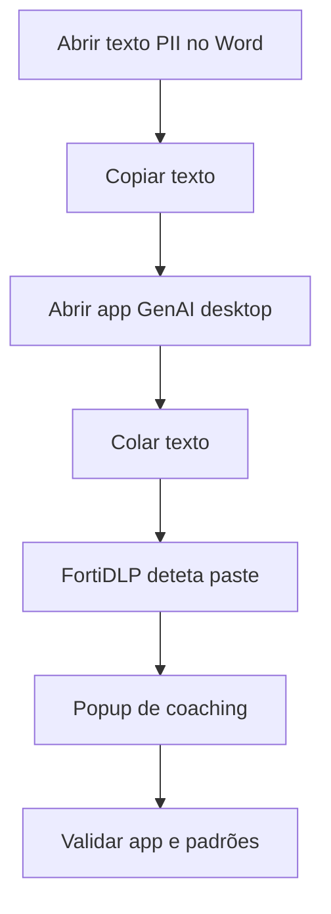

# UC04 — Clipboard para aplicações GenAI desktop

> **GUIÃO RÁPIDO:** preparação + fluxograma + resultado. [Setup completo](../setup/README.md) · [Checklist 5 min](../operations/preflight.md)

## 0. Preparação rápida

| Item | Verificar |
|---|---|
| Aplicações | Word, Claude Desktop ou ChatGPT Desktop; VS Code opcional |
| Label / scope | Endpoint `dlp_rc_demos` |
| Policy Enabled | `DEMO-04B | Sensitive Data Pasted to GenAI` |

- [ ] Texto fictício com PII portuguesa no Word
- [ ] Clipboard Monitoring ON
- [ ] App de destino aberta; regra antiga DEMO-04 desativada

## 1. Fluxograma — executar pela ordem indicada

## 2. O que comprovar na consola

Deteção do paste e destino; **sem bloqueio de colagem demonstrado**.

## Ponte para a UC06 e UC09

1. **UC04:** o paste em Claude Desktop é detetado e gera coaching; não foi bloqueado.
2. **UC06:** no Edge, repetir os mesmos dados sintéticos em ChatGPT Web e demonstrar `Block browser request — Succeeded`.
3. **UC09:** abrir ChatGPT Desktop e demonstrar `Kill process — Succeeded` após arranque limpo.

**Não afirmar** que os três testes garantem bloqueio universal de todas as apps nativas; a ação UC09 foi testada especificamente em `ChatGPT.exe`.

## 3. Plano B

Abrir Detection anterior de ChatGPT/Claude/VS Code.

---

## Detalhe técnico e evidências

**Estado:** **Validado para deteção/coaching**.

## Política e condições
`Sensitive content pasted to desktop application`; padrões portugueses de identificação, telemóveis e telefones; aplicações desktop selecionadas.

## Ações
Display/coaching, evidência de clipboard se disponível; **não implica Block Paste**.

## Reproduzir no laboratório
1. Copiar de Word um texto sintético com identificadores portugueses.
2. Colar em Claude Desktop ou ChatGPT Desktop.
3. Opcional: repetir em VS Code com assistente.
4. Abrir deteção e inspecionar aplicação de destino, padrão e evidência.

## Resultado observado
Deteção confirmada para várias aplicações nativas, incluindo Claude, ChatGPT e VS Code.

## Limitações e notas
Evitar policy duplicada `Sensitive content copied and pasted to desktop application` em paralelo, que produziu ruído; este teste não prova inspeção de calls MCP nem bloqueio nativo de prompt.

## Evidências a recolher (privadamente)
- Policy / template e versão, com scope aplicável.
- Timestamp, endpoint/utilizador fictício e evento que originou a deteção.
- `Associated actions`, respetivos estados e `Action log`.
- Apenas prints **redigidos/anonimizados**, sem emails reais, URL com tokens, paths de perfil, IDs de tenant ou conteúdo pessoal.
