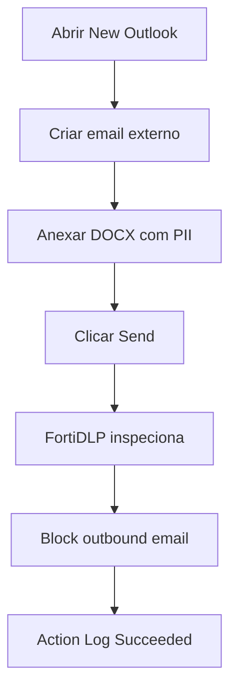

# UC05 — Proteção de email no New Outlook

> **GUIÃO RÁPIDO:** preparação + fluxograma + resultado. [Setup completo](../setup/README.md) · [Checklist 5 min](../operations/preflight.md)

## 0. Preparação rápida

| Item | Verificar |
|---|---|
| Aplicações | New Outlook, FortiDLP Email Add-in e M365 |
| Label / scope | Endpoint `dlp_rc_demos` |
| Policy Enabled | `DEMO-05A | Personal Data Email Protection` |

- [ ] Email Monitoring ON; Add-in New Outlook operacional
- [ ] Mailbox de lab e destinatário externo controlado
- [ ] DOCX com PII sintético pronto

## 1. Fluxograma — executar pela ordem indicada

## 2. O que comprovar na consola

`Block outbound email — Succeeded` para PII. A label **no email** também bloqueou; MPIP **apenas no anexo** não bloqueou no teste.

## 3. Plano B

Abrir Action Log de email PII bloqueado; evitar demonstração de MPIP no anexo-only como se fosse suportada.

---

## Detalhe técnico e evidências

**Estado:** **Validado para dois percursos de bloqueio**.

## Política e condições
`Unauthorized email sent` + New Outlook Email Add-in; filtrar domínio de destinatário externo (ex.: `gmail.com` em contas controladas); padrões PII PT e/ou label do próprio email.

## Ações
`Block outbound email`, `Display message`, captura de ficheiro (quando aplicável).

## Reproduzir no laboratório
1. Criar email destinado a uma caixa externa de teste, anexando documento com identificadores sintéticos.
2. Tentar enviar e observar bloqueio.
3. Repetir com **email em si** classificado MPIP, sem anexos.
4. Testar mensagem sem dados sensíveis para destinatário interno autorizado.
5. Consultar `Associated Actions`.

## Resultado observado
`Block outbound email — Succeeded` para anexo contendo PII; email classificado MPIP também bloqueado. Teste de **anexo apenas MPIP**, não encriptado e com email sem classificação, **passou sem match**.

## Limitações e notas
A limitação de MPIP em anexos está por resolver e não deve ser publicitada como capacidade validada. O envio interno e a classificação de contas dependem dos filtros realmente publicados.

## Evidências a recolher (privadamente)
- Policy / template e versão, com scope aplicável.
- Timestamp, endpoint/utilizador fictício e evento que originou a deteção.
- `Associated actions`, respetivos estados e `Action log`.
- Apenas prints **redigidos/anonimizados**, sem emails reais, URL com tokens, paths de perfil, IDs de tenant ou conteúdo pessoal.
