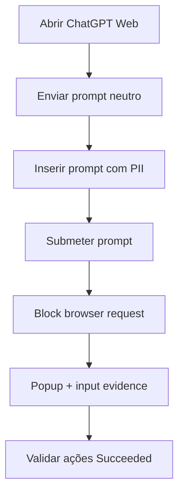

# UC06 — Bloqueio de prompts GenAI Web

> **GUIÃO RÁPIDO:** preparação + fluxograma + resultado. [Setup completo](../setup/README.md) · [Checklist 5 min](../operations/preflight.md)

## 0. Preparação rápida

| Item | Verificar |
|---|---|
| Aplicações | Edge + extensão FortiDLP + ChatGPT Web |
| Label / scope | Endpoint `dlp_rc_demos` |
| Policy Enabled | `DEMO-06 | GenAI Prompt Protection` |

- [ ] Agent 12.8.1 / Policy Templates 8.7.0 (versões testadas)
- [ ] Browser Monitoring e extensão Edge ON
- [ ] Prompts neutro e PII sintética preparados

**Transição:** fazer imediatamente após [UC04 — Clipboard em GenAI Desktop](04-clipboard-genai-desktop.md), reutilizando **o mesmo texto sintético**. Depois executar [UC09 — Terminar ChatGPT Desktop](09-chatgpt-desktop-control.md).

## 1. Fluxograma — executar pela ordem indicada

## 2. O que comprovar na consola

`Block browser request — Succeeded`; `Capture input evidence — Succeeded`. Screenshot `Not Found` e conta SaaS `unknown user`.

## 3. Plano B

Mostrar Detection já validada sem expor conteúdo pessoal no GitHub.

---

## Detalhe técnico e evidências

**Estado:** **Validado** (ChatGPT Web).

## Política e condições
`Sensitive content sent to GenAI web app` — **Agent 12.8.1+ / Templates 8.7.0+**. Seleção de aplicações suportadas e padrões de conteúdo sensível.

## Ações
`Block browser request`, `Capture input evidence`, `Display message`; screenshot não concluído no teste observado.

## Reproduzir no laboratório
1. Abrir ChatGPT Web com uma conta de laboratório.
2. Enviar prompt sem PII e confirmar ausência de bloqueio.
3. Submeter prompt com telemóvel e telefone portugueses de teste.
4. Abrir a deteção; verificar cada `Associated Action`.

## Resultado observado
Foram identificados padrões `Portugal mobile phone number` e `Portugal phone number`. `Block browser request — Succeeded`; `Capture input evidence — Succeeded`; `Display message — Succeeded`. `Capture screenshot evidence — Not Found`. `website_user` surgiu como **unknown user**.

## Limitações e notas
O resultado valida o bloqueio do pedido Web, mas não a identificação da conta SaaS nem OCR. Evitar mostrar texto real do prompt em evidências públicas. A demonstração não provou especificamente a introdução **manual** em contraste com colagem.

## Evidências a recolher (privadamente)
- Policy / template e versão, com scope aplicável.
- Timestamp, endpoint/utilizador fictício e evento que originou a deteção.
- `Associated actions`, respetivos estados e `Action log`.
- Apenas prints **redigidos/anonimizados**, sem emails reais, URL com tokens, paths de perfil, IDs de tenant ou conteúdo pessoal.
