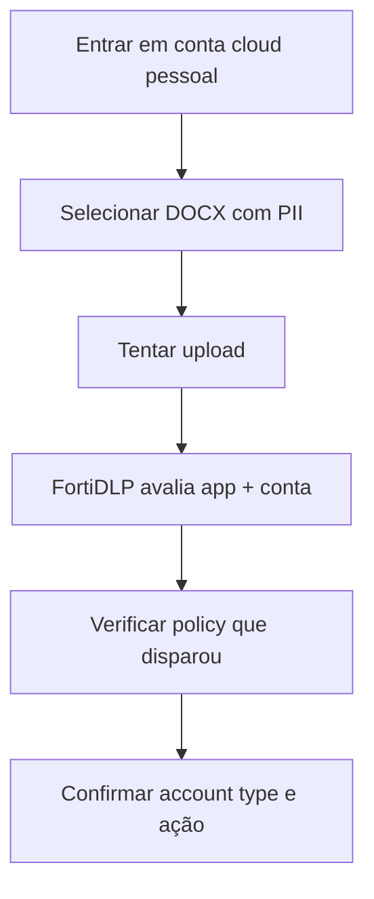

# UC07 — Upload para SaaS pessoal

> **GUIÃO RÁPIDO:** preparação + fluxograma + resultado. [Setup completo](../setup/README.md) · [Checklist 5 min](../operations/preflight.md)

## 0. Preparação rápida

| Item | Verificar |
|---|---|
| Aplicações | Edge/Chrome + Google Drive pessoal e sessão corporativa de teste |
| Label / scope | Endpoint `dlp_rc_demos` |
| Policy Enabled | `DEMO-07 | Personal Cloud Protection` |

- [ ] Domínios de login corporativos configurados no FortiDLP
- [ ] Contas pessoal/corporativa do **laboratório** separadas
- [ ] Policy com SaaS App + account type Non-corporate

## 1. Fluxograma — executar pela ordem indicada

## 2. O que comprovar na consola

**Pendente:** identidade Non-corporate e enforcement próprio da UC07 não foram confirmados. Não confundir deteções UC01/UC03.

## 3. Plano B

Explicar configurações e apresentar a limitação sem atribuir deteções de outra policy.

---

## Detalhe técnico e evidências

**Estado:** **Pendente** (diferenciação de conta e enforcement não confirmados).

## Política e condições
`Sensitive file uploaded` → SaaS Apps no **destino** (não *File Origin*) → tipos de conta `Non-corporate`. Apps alvo: Google Drive, Dropbox, OneDrive.

## Ações
`Block browser upload` pretendido; não declarado como validado.

## Reproduzir no laboratório
1. Configurar domínios corporativos com base nos domínios de **email de login**, não em URLs SharePoint.
2. Selecionar aplicação SaaS e `Non-corporate`.
3. Testar upload de DOCX com PII para conta pessoal; repetir com ficheiro inofensivo.
4. Testar upload corporativo autorizado e comparar deteções.

## Resultado observado
Foi observado upload de ficheiro com label MPIP para Google Drive, mas a deteção tinha origem noutra policy genérica. **Não prova** que UC07 esteja a fazer match.

## Limitações e notas
Uma aplicação com estado `Sanctioned` não implica que a sessão use conta corporativa. Identidade SaaS `Unknown` deve ser analisada separadamente.

## Evidências a recolher (privadamente)
- Policy / template e versão, com scope aplicável.
- Timestamp, endpoint/utilizador fictício e evento que originou a deteção.
- `Associated actions`, respetivos estados e `Action log`.
- Apenas prints **redigidos/anonimizados**, sem emails reais, URL com tokens, paths de perfil, IDs de tenant ou conteúdo pessoal.
