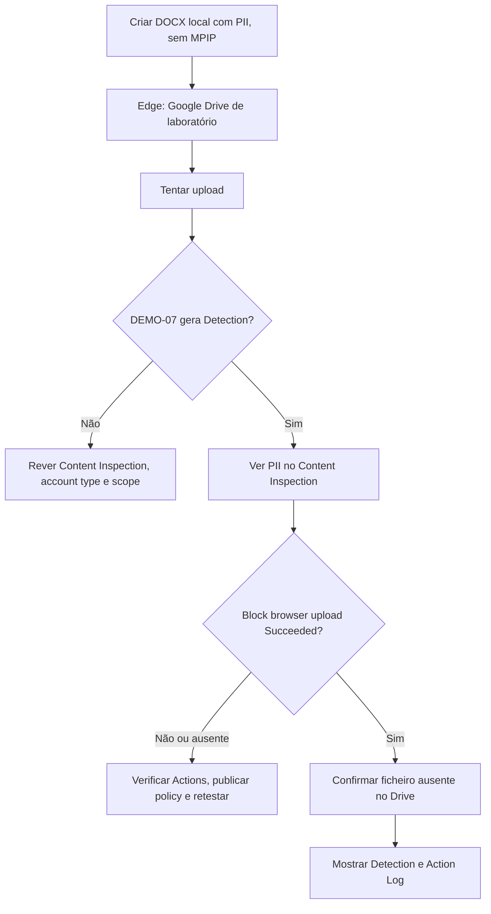

# UC07 — Upload para Google Drive com PII/MPIP

> [Guia rápido de preparação](../setup/README.md) · [Mapa da apresentação](../presentation-flow.md) · [TXT pronto a colar](../../examples/live-demo-paste.txt)

## Estado do dry run

**Deteção validada da própria `DEMO-07` para MPIP e para PII sem MPIP.** Configuração de bloqueio sem override aplicada; último reteste reportado como concluído. Verificar `Block browser upload — Succeeded` no Action Log privado antes de afirmar bloqueio comprovado na sessão com público.

## 0. Preparação rápida

| Item | Verificar |
|---|---|
| Aplicações | Edge/Chrome, Word, Google Drive **de laboratório** |
| Agent | Windows 11, FortiDLP 12.8.1 online |
| Scope | `dlp_rc_demos` no endpoint |
| Policy | `DEMO-07 | Personal Cloud Protection`, `Sensitive file uploaded` |
| SaaS | Google Drive, seleção de tipo `Non-corporate` **e** `Unknown` |
| Content Inspection | Padrões PII portugueses **ou** label MPIP do laboratório |
| Ações | `Block browser upload` ON, `Allow user override` OFF, Display Message ON |
| Documento | **NOVO DOCX LOCAL**, conteúdo PII do TXT, **sem MPIP** e sem linhagem OneDrive |

## 1. Fluxograma

## 2. Resultado observado

- Evento `Browser Events` de upload para `drive.google.com` observado; **não** exige Google Drive Connector.
- Detection `DEMO-07` por documento **MPIP** em paralelo com UC03.
- Detection separada `DEMO-07` por documento com **PII portuguesa sem MPIP**.
- Foram ativados `Non-corporate + Unknown` e `Block browser upload` sem override.
- O operador reportou reteste concluído, mas a captura do último `Action Log` não foi fornecida.

## 3. Notas importantes

`website_user=Unknown` indica que a identidade da sessão SaaS **não foi identificada**; não comprova uma conta pessoal. Um `upload` nos Browser Events é atividade observada e não comprova por si só transferência permitida ou bloqueada. Usar o Action Log e confirmar o estado final no Google Drive.

**Plano B:** mostrar detecções próprias DEMO-07 por MPIP e PII; nunca atribuir a esta UC uma deteção gerada apenas por UC03.
