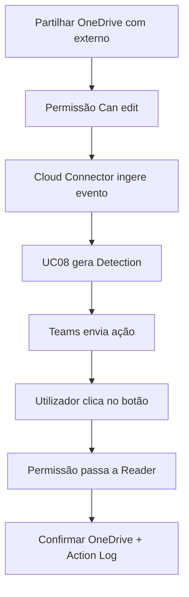

# UC08 — Correção de partilha OneDrive via Teams

> **GUIÃO RÁPIDO:** preparação + fluxograma + resultado. [Setup completo](../setup/README.md) · [Checklist 5 min](../operations/preflight.md)

## 0. Preparação rápida

| Item | Verificar |
|---|---|
| Aplicações | OneDrive/SharePoint Connector + Teams + FortiDLP app dentro do Teams |
| Label / scope | **Utilizador `dlp_rc_demos`** (e endpoint para restantes UC) |
| Policy Enabled | `DEMO-08 | Cloud Sharing Remediation` |

- [ ] Microsoft 365 Cloud Connector e Teams integration Healthy
- [ ] **App FortiDLP instalada no Teams do utilizador** e label no user
- [ ] Ficheiro partilhável, destinatário externo de lab e ~3 min para ingestão

## 1. Fluxograma — executar pela ordem indicada

## 2. O que comprovar na consola

Partilha `Contribute/Can edit` → `READER/Can view`; `Cloud change permission — Succeeded` após clique no Teams.

## 3. Plano B

Preparar partilha antes da apresentação e abrir deteção/Teams já registados se houver atraso.

---

## Detalhe técnico e evidências

**Estado:** **Validado de ponta a ponta**.

## Política e condições
`Sensitive file or folder shared with user on SharePoint or OneDrive`; filtro de destinatário externo (ex.: domínio de teste) e **scope aplicado ao utilizador**.

## Ações
`File action → Change shared file access permission → Viewer` com `Prompt user via action button` via Microsoft Teams.

## Reproduzir no laboratório
1. Confirmar integração Microsoft 365, SharePoint/OneDrive Connector e Microsoft Teams.
2. Atribuir o scope/label ao **utilizador** que cria a partilha.
3. Instalar app FortiDLP no Teams para esse utilizador.
4. Criar partilha do documento de laboratório com permissão de edição para destinatário externo.
5. Confirmar deteção da cloud policy; abrir o Teams e clicar no botão de remediação.
6. Confirmar `Action Log` e `Manage access` no OneDrive.

## Resultado observado
Evento de partilha `Contribute` observado; Teams recebeu mensagem interativa; o utilizador acionou a alteração; ação `Cloud change permission — Succeeded`; permissão final `READER`. Ingestão de eventos demorou cerca de **3 minutos** nesta execução.

## Limitações e notas
No diagnóstico inicial não havia deteção porque a label de scope estava só no endpoint. Após aplicá-la ao utilizador, a deteção surgiu. O primeiro envio Teams falhou com **HTTP 403** até à instalação da app FortiDLP no Teams. O `#EXT#` representa uma identidade B2B Guest: não inferir que é sempre email literal. A funcionalidade de remediação é documentada como **Preview**.

## Evidências a recolher (privadamente)
- Policy / template e versão, com scope aplicável.
- Timestamp, endpoint/utilizador fictício e evento que originou a deteção.
- `Associated actions`, respetivos estados e `Action log`.
- Apenas prints **redigidos/anonimizados**, sem emails reais, URL com tokens, paths de perfil, IDs de tenant ou conteúdo pessoal.
