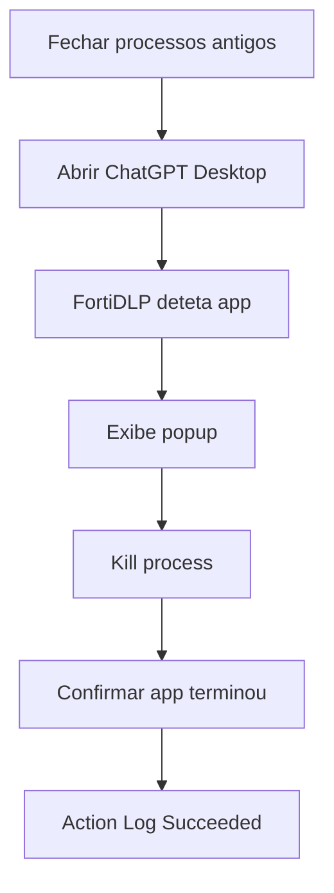

# UC09 — Controlo de ChatGPT Desktop

> **GUIÃO RÁPIDO:** preparação + fluxograma + resultado. [Setup completo](../setup/README.md) · [Checklist 5 min](../operations/preflight.md)

## 0. Preparação rápida

| Item | Verificar |
|---|---|
| Aplicações | ChatGPT Desktop para Windows (`ChatGPT.exe`) |
| Label / scope | Endpoint `dlp_rc_demos` |
| Policy Enabled | `DEMO-09 | Unauthorized GenAI Desktop` |

- [ ] ChatGPT Desktop instalado
- [ ] Unauthorized application used filtra binário ChatGPT.exe
- [ ] Fechar **todos** processos ChatGPT.exe antigos

**Transição:** apresentar logo após [UC06 — GenAI Web](06-genai-web.md). No Web, bloquear o prompt; na app ChatGPT Desktop, terminar a aplicação não autorizada. Não assumir cobertura de outras aplicações.

## 1. Fluxograma — executar pela ordem indicada

## 2. O que comprovar na consola

`Kill process — Succeeded` após arranque limpo. O primeiro teste falhou num PID transitório.

## 3. Plano B

Fechar processos e relançar; se falhar de novo, mostrar Detection bem-sucedida anterior.

---

## Detalhe técnico e evidências

**Estado:** **Validado após arranque limpo**.

## Política e condições
`Unauthorized application used`, `Binary names → ChatGPT.exe`, sem restringir o processo pai.

## Ações
`Kill process` e `Display message`, com link para alternativa corporativa.

## Reproduzir no laboratório
1. Fechar integralmente todas as instâncias da app de laboratório.
2. Confirmar que não restam processos `ChatGPT.exe`.
3. Ativar policy e abrir a aplicação pelo menu Iniciar.
4. Verificar popup, saída da aplicação e `Kill process — Succeeded`.

## Resultado observado
Primeira tentativa: detetou e notificou, mas `Kill process` falhou ao abrir um PID transitório. Após arranque limpo, **Kill process succeeded**. Teste de controlo com Notepad mostrou que o Agent consegue terminar uma app empacotada em WindowsApps.

## Limitações e notas
Apps com vários subprocessos podem criar condições de corrida e exigir arranque limpo na demo. `Kill process` é uma ação reativa após deteção, não garantia de impedir todo o arranque.

## Evidências a recolher (privadamente)
- Policy / template e versão, com scope aplicável.
- Timestamp, endpoint/utilizador fictício e evento que originou a deteção.
- `Associated actions`, respetivos estados e `Action log`.
- Apenas prints **redigidos/anonimizados**, sem emails reais, URL com tokens, paths de perfil, IDs de tenant ou conteúdo pessoal.
