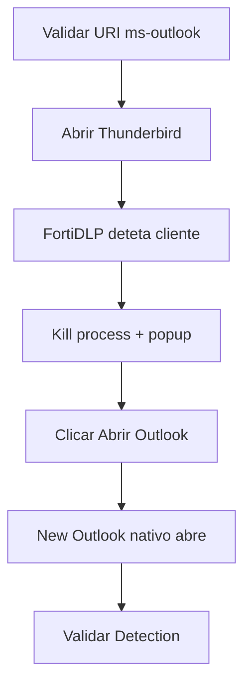

# UC10 — Thunderbird e redirecionamento para Outlook

> **GUIÃO RÁPIDO:** preparação + fluxograma + resultado. [Setup completo](../setup/README.md) · [Checklist 5 min](../operations/preflight.md)

## 0. Preparação rápida

| Item | Verificar |
|---|---|
| Aplicações | Thunderbird + New Outlook nativo |
| Label / scope | Endpoint `dlp_rc_demos` |
| Policy Enabled | `DEMO-10 | Unauthorized Email Client` |

- [ ] Thunderbird instalado como cliente não autorizado
- [ ] New Outlook instalado; `ms-outlook:` testado com `Start-Process`
- [ ] Policy Unauthorized email tool used com Kill + Message

## 1. Fluxograma — executar pela ordem indicada

## 2. O que comprovar na consola

Thunderbird terminado e `ms-outlook:` abriu o New Outlook nativo.

## 3. Plano B

Se URI não abrir, usar fallback Web Outlook e mostrar Kill bem-sucedido anterior.

---

## Detalhe técnico e evidências

**Estado:** **Validado de ponta a ponta**.

## Política e condições
`Unauthorized email tool used`, aplicações de email autorizadas incluindo New Outlook; Thunderbird não autorizado.

## Ações
`Kill process`, `Display message`, link com protocolo `ms-outlook:`.

## Reproduzir no laboratório
1. Confirmar que `Start-Process 'ms-outlook:'` abre New Outlook no endpoint.
2. Fechar Thunderbird completamente.
3. Ativar a policy, abrir Thunderbird e verificar que termina.
4. Clicar no botão `Abrir Outlook corporativo` no popup.
5. Confirmar que é aberta a aplicação **nativa**, não apenas o browser.

## Resultado observado
Thunderbird detetado e terminado; popup exibido; `ms-outlook:` abriu o New Outlook instalado.

## Limitações e notas
A funcionalidade `ms-outlook:` foi **validada neste endpoint**; noutros ambientes depende do registo URI e das políticas de aplicações do Windows. Se não funcionar, usar URL HTTPS do Outlook.

## Evidências a recolher (privadamente)
- Policy / template e versão, com scope aplicável.
- Timestamp, endpoint/utilizador fictício e evento que originou a deteção.
- `Associated actions`, respetivos estados e `Action log`.
- Apenas prints **redigidos/anonimizados**, sem emails reais, URL com tokens, paths de perfil, IDs de tenant ou conteúdo pessoal.
