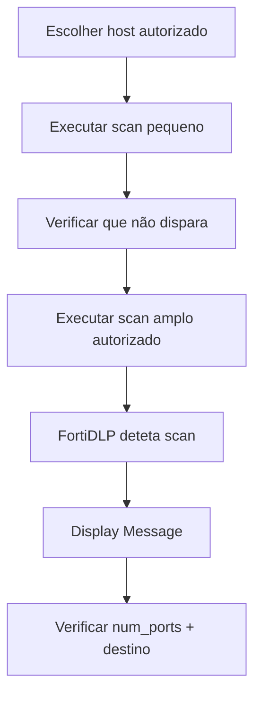

# UC11 — Uso limitado versus reconhecimento excessivo

> **GUIÃO RÁPIDO:** preparação + fluxograma + resultado. [Setup completo](../setup/README.md) · [Checklist 5 min](../operations/preflight.md)

## 0. Preparação rápida

| Item | Verificar |
|---|---|
| Aplicações | Nmap; Zenmap opcional; destino autorizado |
| Label / scope | Endpoint `dlp_rc_demos` |
| Policy Enabled | `DEMO-11 | Excessive Network Reconnaissance` |

- [ ] Nmap instalado e disponível
- [ ] Destino de teste **expressamente autorizado** e acessível
- [ ] Template Outgoing port scan performed configurado sem Isolate/Kill

## 1. Fluxograma — executar pela ordem indicada

## 2. O que comprovar na consola

Scan mais abrangente gerou Detection; scans pequenos não. **Não** é bloqueio do Nmap.

## 3. Plano B

Preferir mostrar a deteção preparada a repetir scans intensivos durante a reunião.

---

## Detalhe técnico e evidências

**Estado:** **Validado como deteção comportamental**, não como prevenção do processo.

## Política e condições
`Outgoing port scan performed`: IPs autorizados, limite superior de portas, quantidade permitida de portas distintas, janela temporal.

## Ações
`Display message` e telemetria; **não tem `Kill process` documentado**.

## Reproduzir no laboratório
1. Identificar host de laboratório com autorização explícita; não utilizar destinos aleatórios.
2. Executar diagnóstico curto a poucas portas e observar ausência de deteção.
3. Executar teste mais abrangente acordado com o proprietário do host, respeitando rate limits.
4. Verificar `num_ports`, `remoteAddr`, `max_port_number` na deteção.

## Resultado observado
Scans reduzidos não geraram deteção no laboratório. Um scan mais abrangente `nmap -T4 -A -v` **gerou deteção**, demonstrando diferença de atividade observada. Não foi comprovado o número preciso de conexões contado pelo detector.

## Limitações e notas
Não afirmar que o FortiDLP permite exatamente '1 execução e bloqueia a 3.ª'. O template conta portas contactadas numa janela, não o número de execuções. Não foram efetuadas ações de Isolate/Kill no teste.

## Evidências a recolher (privadamente)
- Policy / template e versão, com scope aplicável.
- Timestamp, endpoint/utilizador fictício e evento que originou a deteção.
- `Associated actions`, respetivos estados e `Action log`.
- Apenas prints **redigidos/anonimizados**, sem emails reais, URL com tokens, paths de perfil, IDs de tenant ou conteúdo pessoal.
